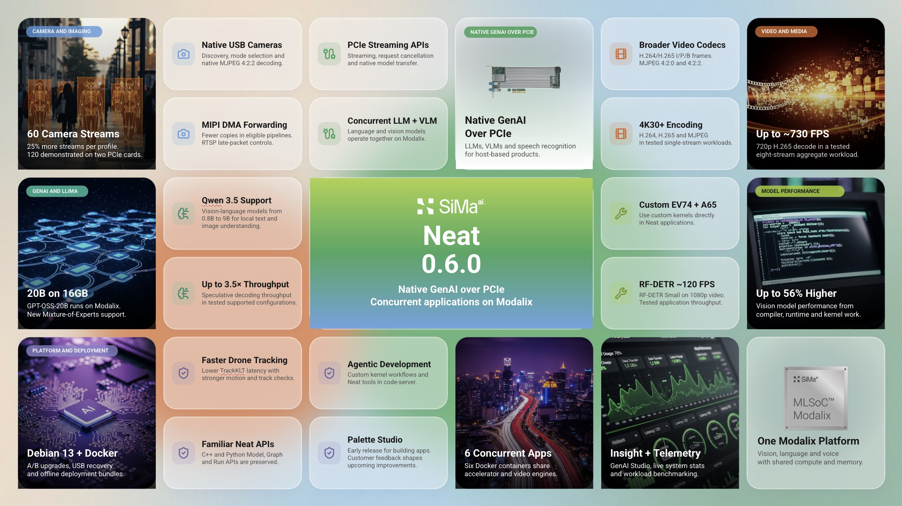

# SiMa.ai Palette

  

**SiMa.ai Palette** is the software stack for building and deploying AI applications on SiMa.ai platforms. It brings together **Palette SDK**, **Neat Runtime**, model compilation, and developer tools.

**Palette SDK** provides the development environment and cross-compilation tools. **Neat Runtime** provides the Python and C++ `Model`, `Graph`, and `Run` APIs for loading compiled model artifacts, composing application logic, and running GStreamer-based AI pipelines on Modalix DevKits and SiMa.ai SoCs. The Python package remains `pyneat`.

**Neat Runtime 0.6.0 release highlights**

<picture>
  <source media="(prefers-color-scheme: dark)" srcset="./0.6.0-dark.jpg" />
  <source media="(prefers-color-scheme: light)" srcset="./0.6.0-light.jpg" />
  
</picture>

## Start Here

- **Documentation:** [developer.sima.ai](https://developer.sima.ai)
- **Neat Runtime:** [core](https://github.com/sima-neat/core)
- **Palette SDK:** [sdk](https://github.com/sima-neat/sdk)
- **Model compilation:** [model-compiler](https://github.com/sima-neat/model-compiler)
- **Examples and applications:** [apps](https://github.com/sima-neat/apps)

## What Palette Provides

- Neat Runtime Python and C++ APIs for composing AI applications
- A `Model`, `Graph`, and `Run` workflow for moving from compiled model package to runtime execution
- Reusable application patterns for object detection, segmentation, tracking, depth estimation, and related edge AI workloads
- Palette SDK and Model Compiler tooling for building against SiMa.ai targets
- Diagnostics and workflow tools for validating pipelines and inspecting application behavior

## Repository Map

| Repository | Purpose |
| --- | --- |
| [core](https://github.com/sima-neat/core) | Neat Runtime C++ and Python APIs (`pyneat`), tutorials, and documentation source |
| [sdk](https://github.com/sima-neat/sdk) | Palette SDK for integrated application development and cross-compilation |
| [model-compiler](https://github.com/sima-neat/model-compiler) | Model Compiler tooling for preparing models for SiMa.ai hardware |
| [apps](https://github.com/sima-neat/apps) | Example applications and reference pipeline patterns |
| [sima-cli](https://github.com/sima-neat/sima-cli) | Developer utilities for setup, assets, and workflow automation |
| [insight](https://github.com/sima-neat/insight) | Runtime inspection, media routing, and interactive testing for Neat Runtime applications |
| [llima](https://github.com/sima-neat/llima) | Runtime and compile-time tooling for LLM and VLM workloads |
| [playbooks](https://github.com/sima-neat/playbooks) | Coding-agent playbooks for common Palette development workflows |

Private repositories support internal integrations, build infrastructure, model assets, and fleet-based test execution.

## Development Model

Palette is designed for teams building production AI applications at the edge:

- Build and validate application behavior close to the target runtime
- Keep model packages, application composition, and runtime execution as separate concerns
- Reuse tested application patterns instead of hand-maintaining brittle pipelines
- Support both direct developer workflows and agent-assisted development

For installation, build steps, tutorials, and API references, use the current docs at [developer.sima.ai](https://developer.sima.ai).
